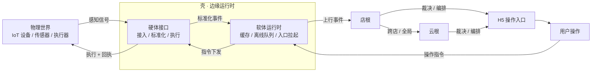

# 真实端壳契约 v0.7.0

> 适用范围：`Trae-RealEnds` 内全部壳工程（App / 小程序 / PC / 浏览器兜底）。
> 本文件是**唯一真相**：壳、H5、发行部署都以本文对齐。改契约先改本文，再改实现。

---

## 0. 定位、角色与红线

### 0.1 定位：两层一面 + 一条贯穿

> 壳是位于物理世界与数字世界之间的边缘运行时：以设备、网络与现场约束为输入，承担感知接入、指令执行、离线缓冲与系统整合；以「两层一面、一条贯穿」组织职责，只决定「怎么送、送多少、何时送」，不裁决业务。

「边缘」在这里指**位置与能力边界**，不是裁决权。壳离现场最近，最适合做适配、缓冲、降级与执行；但离现场近，不等于可以改写业务真相。跨店库存、结算、风控、权限矩阵归云根，店内真相副本归店根。

| 面 | 职责 | 不承担 |
|---|---|---|
| 硬体接口面（层） | 设备能力探测与适配：传感器、打印、称重、扫码、NFC/蓝牙、网络状态；能力缺失时给出降级路径 | 硬件本身、驱动、固件与制造 |
| 软体运行时面（层） | 统一桥 `window.Shell`、方法分发、事件、缓存、离线队列、幂等重放、插件运行时 | 业务规则、优惠判定、订单状态、金额 |
| 系统整合面（横切） | 身份与会话、发布与升级、运维与可观测、隐私与合规、商店/MDM 交付 | 把整合能力变成业务裁决 |
| 连接/数据贯穿 | 弱网与断网、多路径传输、store-and-forward、本地读模型与对账、时钟与网络上下文 | 用本地缓存替代云端真相 |

**对接是双向的**：感知（物理 → 数字：采集、上报、对账）与执行（数字 → 物理：打印、开柜、亮屏、震动、播报）。只做上行，壳就退化成上传组件。

判断一项能力该不该进壳，先过三个问题：

1. 断网时，壳还能独立完成它吗？
2. 换硬件或换端时，改的是壳还是业务？
3. 出争议时，裁决发生在边缘，还是在云根/店根？

### 0.2 角色

| 角色 | 持有 | 不持有 |
|---|---|---|
| 云根 | 全局真相：跨店库存、结算、风控、权限矩阵 | 设备状态 |
| 店根（PC 壳 / 门店网关） | 店内真相副本：本店库存、工位/桌台、离线额度 | 跨店结算 |
| 端壳（App / 小程序 / PC 客户端 / 浏览器） | 会话、缓存、离线队列、设备画像、地理与网络上下文 | 任何业务裁决 |

### 0.3 红线

**红线**：壳只决定「怎么送、送多少、何时送」；「送什么、算得对不对」由云根/店根决定。
壳内不得本地判定优惠、改订单状态、改金额。

### 0.4 IoT 接入与入口化

> 壳接入并标准化物理世界的 IoT 信号，经店根/云根裁决后，把结论转化为可拉起、可鉴权、可降级的用户操作入口；用户操作再由壳下发为设备执行与回执。壳负责「送达与执行」，不负责「裁决与编排内容」。



| 环节 | 负责方 | 产物 | 壳不承担 |
|---|---|---|---|
| IoT 接入 | 硬体接口面 | 标准化事件：设备 ID、类型、值、时钟、去重键 | 解析业务含义、判定结果 |
| 裁决 | 店根 / 云根 | 可执行结论 | 本地判定优惠、库存、金额 |
| 入口编排 | 业务 H5 + 店根/云根 | 深链、卡片、待办、设备面板 | 决定给用户看什么 |
| 执行 | 硬体接口面 | 指令 + 回执 | 伪造执行成功 |

**IoT 接入要求**

- 协议适配只走构建期插件（MQTT / BLE / 串口 / 扫码 / 称重等），禁止运行时远程加载；探测不到能力时降级并如实上报。
- 事件必须带设备身份、时钟与幂等键；进入品牌作用域离线队列，重连后按 `shell:queue-restored` 对账。
- 设备身份与令牌由云端校验（见 [cajob-iot-spec](../cajob-iot-spec/)）；壳不落凭证、不替代鉴权。
- `caps.allow` 只做构建期裁剪，不是安全边界。

**入口形态**

| 入口 | 触发 | 必带参数 | 降级 |
|---|---|---|---|
| 近场触发 | 扫码 / NFC / BLE / 地理围栏 | `entryId`、设备或点位、上下文 | 手输编码 / 搜索 |
| 工作台 | launcher、卡片、待办、通知 | `entryId`、会话、幂等键 | 静态入口页 |
| 设备面板 | 状态 / 告警 | 设备 ID、快照版本 | 只读状态 + 重试 |
| 离线入口 | 断网 / 弱网 | 本地可用性、排队数 | 先排队后提交 |

**执行闭环**

指令必须带幂等键并返回回执；失败可重试、可对账。壳不得把「已发送」标成「已成功」，执行结果回到店根/云根形成闭环。

红线不变：裁决在店根/云根，入口内容由业务 H5 编排；壳只负责接入、缓冲、拉起与执行。

> 本节是定位口径；具体设备协议与入口清单按端另行定义。

---

## 1. 版本与命名

| 字段 | 当前值 | 说明 |
|---|---|---|
| `contractVersion` | `0.7.0` | 本文版本，语义化 |
| `shellVersion` | 各壳自报 | 壳内核版本 |
| `appVersion` | 各壳自报 | 商店发版版本 |

品牌命名空间统一为 `window.Shell`，品牌别名保留兼容：

| 品牌 | 统一入口 | 兼容别名 | 事件前缀 |
|---|---|---|---|
| 知味工场 | `window.Shell` | `window.ziwayOS` | `shell:` / 兼容 `ziwayos:` |
| 捷才工友 | `window.Shell` | `window.jechanOS` | `shell:` / 兼容 `jechan:` |
| XSO | `window.Shell` | `window.xsoOS` | `shell:` / 兼容 `xso:` |
| Cajob | `window.Shell` | `window.cajobOS` | `shell:` / 兼容 `cajob:` |

> 兼容别名保留 2 个大版本，H5 逐步迁移到 `window.Shell`。

---

## 2. 能力清单（capabilities）

能力 ID 采用 `域.能力` 命名。H5 **禁止用 UA 判断能力**，只读 `capabilities`。

### 2.1 核心（所有壳必须具备）

| 能力 | 说明 |
|---|---|
| `core.bridge` | 桥存在，可调用 |
| `core.ready` | 支持 `shell:ready` 握手 |
| `core.statusBar` | 状态栏样式与颜色 |
| `core.backButton` | 硬件返回键拦截与回退 |
| `core.splash` | 启动屏控制 |
| `core.openExternal` | 外部浏览器/系统应用打开 |
| `core.vibrate` | 震动反馈 |
| `core.safeArea` | 安全区上报 |

### 2.2 可选能力

| 能力 | 说明 | 权限 |
|---|---|---|
| `core.share` | 系统分享面板 | 无 |
| `core.push` | 推送注册与消息 | 通知 |
| `core.deeplink` | 深链接收与验签 | 无 |
| `geo.current` | 单次定位 | 定位 |
| `geo.watch` | 持续/后台定位 | 定位（后台） |
| `io.camera` | 拍照/录像 | 相机 |
| `io.file` | 选择与保存文件 | 存储 |
| `io.clipboard` | 读写剪贴板 | 无 |
| `net.state` | 在线状态、网络类型、延迟 | 无 |
| `net.offlineQueue` | 离线写队列（P1） | 无 |
| `store.localMirror` | 本地只读镜像（P1） | 无 |
| `edge.storeRoot` | 接入店根（P2） | 无 |
| `sec.attest` | 设备密钥签名 | 无 |
| `obs.telemetry` | 端上可观测上报 | 无 |
| `policy.fetch` | 拉取云端边缘策略 | 无 |
| `sys.biometric` | 生物识别 | 生物识别 |
| `identity` | 设备身份与令牌轮换（令牌只存 `secureStore`） | 无 |

### 2.3 平台支持矩阵

`✓` 原生可用　`◐` 降级可用　`—` 不适用　`✗` 不支持

| 能力 | Android | iOS | 微信小程序 | Windows | macOS | 浏览器 |
|---|---|---|---|---|---|---|
| `core.bridge` | ✓ | ✓ | ✓ | ✓ | ✓ | ✓ |
| `core.statusBar` | ✓ | ✓ | ◐ | — | — | ✗ |
| `core.backButton` | ✓ | ◐ | ◐ | ✗ | ✗ | ✗ |
| `core.splash` | ✓ | ✓ | ◐ | ✓ | ✓ | ✗ |
| `core.openExternal` | ✓ | ✓ | ✗ | ✓ | ✓ | ◐ |
| `core.vibrate` | ✓ | ◐ | ✓ | ✗ | ✗ | ⚙ |
| `core.share` | ✓ | ✓ | ◐ | ◐ | ◐ | ◐ |
| `core.push` | ✓ | ✓ | ✗ | ◐ | ◐ | ✗ |
| `core.deeplink` | ✓ | ✓ | ◐ | ✓ | ✓ | ✗ |
| `geo.current` | ✓ | ✓ | ◐ | ✗ | ✗ | ◐ |
| `geo.watch` | ✓ | ◐ | ✗ | ✗ | ✗ | ✗ |
| `io.camera` | ✓ | ✓ | ✓ | ◐ | ◐ | ◐ |
| `net.state` | ✓ | ✓ | ✓ | ✓ | ✓ | ✓ |
| `net.offlineQueue` | ✓ | ✓ | ✓ | ✓ | ✓ | ✓ |
| `sec.attest` | ✓ | ◐ | ✗ | ✓ | ◐ | ✗ |
| `obs.telemetry` | ✓ | ✓ | ✓ | ✓ | ✓ | ✓ |
| `identity` | ◐ | ◐ | ◐ | ◐ | ◐ | ◐ |

小程序 `core.vibrate` 走 `wx.vibrateShort`；`push` 在小程序为 ✗，改用订阅消息（`core.subscribe`，另列）。

---

## 3. 握手协议

页面加载后壳必须立即派发一次：

```js
window.dispatchEvent(new CustomEvent('shell:ready', {
  detail: {
    contractVersion: '0.7.0',
    shellVersion: '0.1.0',
    appVersion: '0.1.0',
    brand: 'ziway',
    platform: 'android',        // android | ios | mp-weixin | win32 | darwin | browser
    capabilities: ['core.bridge', 'core.statusBar', 'net.state', /* ... */],
    locale: 'zh-CN',
    device: { model: 'Pixel 6', osVersion: '14' },
    net: { online: true, type: 'wifi', latencyMs: 42 },
    safeArea: { top: 24, bottom: 16, left: 0, right: 0 },
    ends: ['hp', 'cp', 'ep', 'sp'],   // 该壳支持的身份端
    currentEnd: 'hp'
  }
}))
```

H5 若在 `DOMContentLoaded` 后仍未收到（超时 1.5s），视为「非壳环境」，退化为纯网页模式。
壳必须支持**重放**：H5 通过 `Shell.call('core.handshake')` 补取当前握手快照。

---

## 4. 调用协议

统一为异步：

```ts
Shell.call<Method extends CapabilityMethod>(method: Method, args?: Input): Promise<Output>
```

- 方法名 = 能力 ID + 动作：`core.statusBar.setStyle`、`net.offlineQueue.enqueue`。
- 未声明能力的方法调用 → 立即 reject `E_UNAVAILABLE`，不得静默。
- 所有调用必须带 `timeout`（默认 10s，定位 20s，文件 60s）。

### 4.1 错误码

| 码 | 含义 | H5 应做 |
|---|---|---|
| `E_UNAVAILABLE` | 平台不支持 | 隐藏入口或改降级路径 |
| `E_PERMISSION_DENIED` | 权限被拒 | 引导开启，不重复弹窗 |
| `E_USER_CANCEL` | 用户取消 | 静默 |
| `E_TIMEOUT` | 超时 | 可重试一次，然后降级 |
| `E_OFFLINE` | 当前离线 | 转离线队列 |
| `E_CONFLICT` | 版本冲突 | 拉快照后重试 |
| `E_RATE_LIMITED` | 频控 | 退避 |
| `E_BAD_ARGS` | 参数错 | 开发期修复，不得重试 |
| `E_INTERNAL` | 壳内部错误 | 上报 + 降级 |

---

## 5. 事件

统一前缀 `shell:`。所有事件必须带 `ts`（单调毫秒）与 `seq`。

| 事件 | 载荷 | 说明 |
|---|---|---|
| `shell:ready` | 见第 3 节 | 握手 |
| `shell:resume` / `shell:pause` | `{ts}` | 前后台 |
| `shell:net-change` | `{online, type, latencyMs}` | 网络变化 |
| `shell:back` | `{level}` | 返回键意图，H5 可 `preventDefault` |
| `shell:push-token` | `{token, provider}` | 推送令牌 |
| `shell:push-received` | `{payload, foreground}` | 收到通知 |
| `shell:push-action` | `{action, payload}` | 用户点通知 |
| `shell:deeplink` | `{url, verified}` | 深链，`verified=false` 必须丢弃 |
| `shell:permission-change` | `{name, state}` | 权限变化 |
| `shell:queue-flush` | `{confirmed, conflicts, rolledBack}` | 队列回放结果 |
| `shell:policy-update` | `{version, patch}` | 边缘策略更新 |
| `shell:error` | `{code, method, detail}` | 壳内部错误 |
| `shell:identity-changed` | `{deviceId, owner, scopes, expiresAt, source}` | 设备令牌刷新成功，不含令牌 |
| `shell:identity-expired` | `{code, deviceId}` | 令牌被吊销/过期，安全存储已清空 |

---

## 6. 降级矩阵

| 场景 | 壳行为 | H5 可见信号 |
|---|---|---|
| 完全无网 | 读本地镜像；写全部入队；顶部提示 | `net.online=false` |
| 弱网（>800ms 或丢包>5%） | 图片降质量、非关键请求延后、预取暂停 | `net.quality='poor'` |
| 定位权限拒绝 | 不重复弹窗，走手动选择地址 | `capabilities` 不含 `geo.current` |
| 通知权限拒绝 | 站内消息兜底 | `core.push` 降级 |
| 进入后台 | 暂停轮询与动画，保留队列 | `shell:pause` |
| 存储不足 | 只保留队列，清镜像缓存 | `shell:error` `E_INTERNAL` |
| 壳版本过低 | 显示升级引导页，不静默降级 | `contractVersion` 比对 |

---

## 7. 权限时机表

| 权限 | 申请时机 | 禁止 |
|---|---|---|
| 通知 | 用户首次产生「需要被提醒」的行为后 | 冷启动即弹 |
| 定位 | 用户触发「附近/到店」功能时 | 首屏静默申请 |
| 相机 | 用户点击扫码/拍照时 | 后台预申请 |
| 相册/文件 | 用户点击上传时 | 启动即申请 |
| 生物识别 | 用户开启「快速登录」时 | 强制 |

原则：**先解释后申请**，被拒后提供手动路径，不在同一次会话重复弹窗。

---

## 8. 离线契约（P1）

### 8.1 队列条目

```json
{
  "id": "uuidv7",
  "seq": 12,
  "op": "order.create",
  "risk": "money | stock | read",
  "payload": {},
  "idem": "sha256(op + payload + subjectId + dayKey)",
  "clientWall": "2026-10-30T14:20:00+08:00",
  "mono": 1024,
  "device": "dev-fp-xxxx",
  "schema": "order.create/v1",
  "state": "queued | inflight | confirmed | conflict | rolled-back | rejected"
}
```

### 8.2 规则

1. **幂等键必填**，服务端按 `idem` 去重，重放 N 次只生效一次。
2. **排序用 `seq` + 单调时钟**，不信任设备墙钟。
3. **只追加不改写**：状态迁移只允许单向，保留完整迁移日志。
4. **回放分批**，每批 ≤20 条，按 `seq` 升序；单批内同 `risk` 归类。
5. **结果映射**：`2xx/202` → `confirmed`；`409` → `conflict`（按第 9 节裁决）；`410` → `rolled-back`；`4xx` 参数类 → `rejected`（不再重试）。
6. **离线额度**：`risk=money` 的条目需携带租约 `leaseId`，额度、单笔上限、TTL 由云根下发；超时未联网则自锁为只读。

### 8.3 本地镜像

- 按 `subjectId + role` 裁剪，只缓存该身份可见的读模型。
- 带 `etag` 与 `schemaVersion`；`schema` 变更时整体废弃重建。
- 上限（默认）：≤50MB、≤2 万条；超限按 LRU 淘汰。

---

## 9. 冲突裁决

| 风险类 | 冲突策略 | 责任方 |
|---|---|---|
| `money` | 不自动通过：进人工复核队列，前端显示「待确认」 | 云根 |
| `stock` | 店根按版本号裁决，失败方回滚并提示 | 店根 |
| `read` / 展示类 | 后写优先（LWW），静默覆盖 | 端壳 |
| 身份/权限类 | 一律以云根为准，端立即降级 | 云根 |

禁止：端壳对 `money` 类做任何本地裁决。

---

## 10. 店根契约（P2 概要）

端壳 ↔ 店根（PC 壳本地 HTTP，局域网内，端口约定 `7321`）：

| 接口 | 作用 |
|---|---|
| `POST /edge/lease` | 端获取店内租约：`{leaseId, ttl, limits}` |
| `POST /edge/commit` | 原子提交 `{leaseId, ops[]}`，整批成功或整批失败 |
| `GET /edge/snapshot?since=` | 拉取店内读模型增量 |
| `GET /edge/catalog` | 店根商品读模型 + 下行游标 |
| `GET /edge/ui/conflicts` | 冲突复核运营页（静态免鉴权；页内数据接口仍要 token） |
| `GET /edge/health` | 店根存活与云根连通性 |

店根 ↔ 云根（服务端之间，双向游标、各自独立；参考实现见 `cloud-root/`）：

| 接口 | 方向 | 作用 |
|---|---|---|
| `POST /cloud/events` | 店根 → 云根 | 上行事件批量回传；`409` 停在冲突点、不跳过 |
| `GET /cloud/catalog?since=` | 云根 → 店根 | 下行商品/价格增量；整批落库后才推进游标 |

规则：
- 单事务提交，带 `version`；冲突返回 `409` 与当前版本，端必须重拉快照。
- 端离线超过租约 TTL 自动降为「只读」，不允许继续成交。
- 店根与云根断开时，店根标记 `cloudOffline=true`，端据此切换降级文案。
- 上行与下行互不阻塞：下行失败不置 `cloudOffline`、不参与上行退避；重复下发幂等（不重复写事件）。

---

## 11. 安全基线

1. **导航白名单**：仅允许业务域，外部链接一律 `openExternal`，禁止 WebView 内跳转第三方。
2. **深链验签**：`brand://open?u=<base64url>&ts=&sig=<hmac>`，签名失败或 `ts` 超 5 分钟一律丢弃。
3. **短票据**：离线授权票据有效期 ≤10 分钟，设备密钥签名，服务端可达即吊销。
4. **证书固定**：P1 起对主业务域开启。
5. **日志脱敏**：手机号、身份证、定位、地址在落盘与上报前脱敏。
6. **不落敏感明文**：队列与镜像中禁止存放支付凭证原文。

---

## 12. 自检页（每壳内置）

路径 `shell-selftest`，10 项，逐项输出 `pass / fail / unsupported` 与详情，可导出 JSON：

| # | 检查 |
|---|---|
| 1 | 桥存在，`capabilities` 非空且与平台矩阵一致 |
| 2 | 收到 `shell:ready`，含 `safeArea` 与 `ends` |
| 3 | 状态栏样式生效（颜色与前景对比达标） |
| 4 | 返回键拦截不穿透，连续回退到身份选择页 |
| 5 | 震动可用或明确 `unsupported` |
| 6 | 分享面板可唤起 |
| 7 | 定位授权流程与拒绝路径正确 |
| 8 | 推送令牌就绪，或明确 `unsupported` + 站内兜底 |
| 9 | 飞行模式切换触发 `shell:net-change` |
| 10 | 断网兜底页可打开，镜像可读 |

---

## 13. 验收（Definition of Done）

- [ ] 九壳 `capabilities` 与第 2.3 节矩阵一致，差异仅限平台
- [ ] `shell:ready` 1.5s 内到达；超时降级路径可走
- [ ] 自检页 10/10（或明确 `unsupported` 项 ≤2 且已登记）
- [ ] 断网冷启动 ≤1s 出本地内容
- [ ] 队列 100% 落地，联网重放零重复、零丢失
- [ ] 无 UA 判断残留（H5 侧 grep 校验）
- [ ] 白屏、崩溃、权限拒绝率可回流，带品牌/端/版本/页面

---

## 14. 变更流程

1. 改能力或事件 → 先改本文并升级 `contractVersion`。
2. 破坏性变更走 major，壳与 H5 同时发；只增不改走 minor。
3. 每壳 README 记录「已实现能力 / 未实现能力 / 降级说明」。
4. 发布前跑 `scripts/contract-check.mjs`（校验各壳生成的 `capabilities` 与本文矩阵一致）。

---

## 15. 分期

| 阶段 | 内容 | 状态 |
|---|---|---|
| P0 | 本契约 + 自检页 + `capabilities` 上报 | 进行中 |
| P1 | 本地镜像 + 离线队列 + 幂等重放 + 策略下发 | 待启动 |
| P2 | 店根（PC 壳本地库、局域网发现、原子扣减、上行回传/下行读模型/退避调度） | 已实现（`edge-store/`） |
| P3 | 策略自动调优、围栏触发、批量对账 | 规划中 |

---

## 16. v0.3.0 变更（UendOS SDK 化）

本版不改变运行时行为（`shell-core` 仍为 v0.2.0，能力矩阵、事件、错误码、握手字段不变），新增的是**工程化契约**：

1. **配置契约**：`uendos.config.json`（`schemaVersion: 1`）与 `schema/uendos.config.schema.json` 固化品牌、端、targets、包名等字段；`@uendos/contract` 的 `validateConfig()` 为唯一校验入口。
2. **工具链契约**：`uendos init/add-end/sync/doctor/conformance/pack/publish`，其中 `sync --check` 要求生成产物与配置严格一致（CI 拦截手改）。
3. **一致性契约**：`@uendos/conformance` 用 39 项断言（结构 8 / 握手 4 / 端切换 4 / 事件 4 / 错误协议 5 / 离线队列 6 / 店根适配 6 / 契约自洽 2）在 vm 沙箱验收任意品牌桥，无需真机。
4. **文档入口**：开发者指南见 [`sdk/README.md`](../sdk/README.md)；运行时源码唯一真相仍为 `shell-core/src/core.js`。

---

## 17. v0.3.1 变更（一键出包）

运行时与 39 项断言不变；本版补齐「从工程到安装包」的工具链：

1. **启动模式**：配置新增可选 `launchMode`。
   - `portal`（默认）：`server.url` 指主端，与原四个品牌壳一致；
   - `launcher`：不固定主端，先加载本机选择页，所选端写入 `endKey` 后跳转，重启保持；`?picker=1` 回到选择页。
2. **品牌资源**：`uendos init` / `uendos assets` 按 `accent` 与品牌字样生成 `assets/icon.png`（1024）与 `splash.png`（2732），首次 `pack` 通过 `@capacitor/assets` 展开到 Android/iOS 各尺寸，之后不覆盖自定义图标。
3. **打包**：`pack --target app` 自动补齐 `npm install` 与 `cap add android`；`--release` 生成 `android/uendos-signing.gradle`，密码只从 `UENDOS_KEYSTORE_PASSWORD` / `UENDOS_KEY_PASSWORD` 读取，不落盘。`pack --target ios` 需 macOS，`--release` 产出 `.xcarchive`。
4. **远程端白名单**：`capacitor.config.json` 的 `server.allowNavigation` 由 `ends` 的 host 自动生成，避免远程端被 WebView 拦截。

---

## 18. v0.3.2 变更（版本档位）

运行时不改，新增构建期档位 `profile`，同一套云根与壳代码按档裁剪产物与声明能力：

| 档位 | 默认 target | 允许 target | 声明能力 |
|---|---|---|---|
| `lite` 轻量版 | `app` | `app` | 9/18（无 push/camera/biometric/offlineQueue/deeplink/edge.storeRoot） |
| `standard` 标准版 | `app/pc` | `app/pc/mp` | 16/18（无 subscribeMsg/edge.storeRoot） |
| `pro` 增强版 | `app/pc/mp` | `app/pc/mp` | 18/18 |

1. `uendos.config.json` 新增可选 `profile`；`contractVersion` 升为 `0.3.2`。
2. `uendos init --profile` 决定默认 target 与默认 `launchMode`；`lite` 不允许 `pc/mp`。
3. `uendos profile [--json]` 输出三档矩阵；`uendos doctor` 校验档位与 target 是否匹配。
4. **边界**：`profile` 只裁剪构建期产物与声明能力，不是权限边界；租户/角色权限仍由云根校验。业务规则不得因档位分叉。
5. 设计说明与分发建议见 [`uendos-editions.md`](./uendos-editions.md)。

---

## 19. v0.4 M1 变更（个性化主题）

运行时不改协议，只新增壳自有页面的主题能力：

1. `uendos.config.json` 新增可选 `theme`：`{ mode: 'light' | 'dark', tokens: { accent, bg, surface, ink, inkMuted, line, radius, fontScale } }`；未配置时沿用浅色默认值，旧工程零改动。
2. 运行时把 token 落成 CSS 变量（`--uendos-bg` / `--uendos-ink` / `--uendos-accent` / `--uendos-radius` / `--uendos-fs-*`），并同步设置 `color-scheme` 与 `<meta name="theme-color">`。
3. `Shell.theme` 暴露给 H5：`{ mode, tokens }`；握手 payload 同步携带 `theme`，`accent` 以主题 accent 为准。
4. **作用域**：只覆盖壳自有页面（选择页 / 启动兜底 / 错误页）。远程 H5 根不强制套主题，可由 H5 读取 `Shell.theme` 自行适配。
5. 校验：颜色必须 `#RRGGBB`，`radius` 0–28，`fontScale` 0.9–1.2；未知 token 直接拒绝。`doctor` 打印生效主题，`sync --check` 校验主题是否已写入品牌桥。
6. 设计草案与后续 L2/L3（入口编排、插件）见 [`uendos-customization-v0.4.md`](./uendos-customization-v0.4.md)。

---

## 20. v0.4 M2 变更（入口编排与生成式选择页）

1. 配置新增可选 `entry`：`{ title, subtitle, rememberLast, order: [endId], groups: [{ label, ends: [endId] }] }`；字段均可缺省，缺省时用默认标题与配置顺序。`order` 与 `groups` 引用的端必须存在，同一端不得出现在多个分组。
2. 选择页改为 `sync` 产物 `shell/picker.html`（仅含 app target 时生成），与品牌桥一起受 `sync --check` 保护；`index.html` 只做 `./picker.html` 跳转，`prepare:web` 把选择页复制进 `dist`。
3. 展示规则：先按 `groups` 顺序渲染分组，未分组的端按 `order` 追加在最后；分组只影响展示，不改变 `ends` 的可用性。
4. `rememberLast: false` 时既不自动跳转也不写 `endKey`；`?picker=1` 始终可强制回到选择页。
5. `doctor` 打印 `端数 / 组数 / 顺序 / 是否记住`；`entry` 非法值由 `validateConfig` 拒绝。
6. 设计草案见 [`uendos-customization-v0.4.md`](./uendos-customization-v0.4.md)。

---

## 21. v0.4 M3 变更（插件注册）

桥版本 `2 → 3`，契约版本 `0.4.0`。新增的是**构建期插件**，不是远程加载：

1. `ShellCore.registerPlugin(id, factory)`：CLI 在 `sync` 时把插件运行时以 `ShellCore.registerPlugin("<id>", function () { <runtime.js 原文> });` 嵌进品牌桥，位置在 `ShellCore.create(cfg)` 之前。**禁止运行时远程加载插件代码**，插件必须 `npm install` 进工程并锁版本（提交 `package-lock.json`）。
2. 插件包根目录提供 `uendos.plugin.json`：`{ id, version, runtime, asserts?, env?, capabilities, methods, requires? }`；配置只写包名：`{ "plugins": ["@scope/uendos-plugin-x"] }`。能力声明以插件包为唯一真相。
3. 注册即校验，任一条不满足则返回 `false` 且不注册（不静默降级）：
   - `id` 唯一，且与配置中的包名一致；
   - 能力不得与内置 18 项重名；多个插件不得声明同一能力（暂无 provider 优先级机制）；
   - 方法命名空间（首个 `.` 之前）必须是该插件自己声明的能力，且不得占用 `core` / `edge` / `offline` / `desktop` / `shell`；
   - 方法与内置 `METHODS` 或其他插件方法不得重名，且必须为函数；
   - `capabilities` 与 `methods` 均非空。
4. 激活与能力回落：`detect(env)` 为真才 `active`；声明值取合法枚举（`✓`/`◐`/`─`/`web`），否则按 `✓`；未激活的能力一律回落 `─`。`Shell.capabilities` 为内置能力 + 插件能力合并；未激活插件的方法调用返回 `E_UNSUPPORTED`，插件抛错统一映射 `E_NATIVE`。
5. `Shell.plugins` 返回 `[{ id, version, active }]`，握手 payload 同步携带 `plugins`，线上排障可按版本定位。
6. `uendos conformance` 合并插件自带 `conformance.mjs`（默认导出 `[{ name, run(Shell) }]`），输出 `39 + N`；插件未提供断言时只跑内置 39 项，断言格式非法按失败计。
7. `profile=lite` 不允许插件（`validateConfig` 与 `uendos plugin add` 均拒绝）。
8. `uendos pack` 打包前强制 `sync --check`，保证嵌入桥里的插件运行时与配置一致；`uendos sync --check` 同时校验品牌桥与 `shell/picker.html`。
9. CLI：`uendos plugin add <包名>`（预检已安装 + 声明合法 → 写配置 → `sync`）、`uendos plugin remove <包名>`（移除 → `sync`）；`doctor` 打印 `插件：N 个 · id@version` 与 `生效能力集：内置 18 项 + 插件 N 项（能力名）`。
10. **插件「热更新」= 构建期升级**：`uendos plugin update [<包名>...] [--spec <npm spec>]` 执行 `npm install <包名>@latest`（`--spec` 可指定具体版本、tarball 或内网源）→ 重新校验声明与冲突 → `sync`；变更随壳包发布，`package-lock.json` 必须提交。**不提供运行时动态加载插件代码的通道**：桥里只存在构建时嵌入的 runtime，`Shell.plugins` 上报的只是已嵌入版本。

---

## 22. v0.5 变更（能力白名单 `caps.allow`）

桥版本保持 `3`，契约版本 `0.5.0`；只新增配置与构建期裁剪，运行协议不变。

1. 配置：`"caps": { "allow": ["share", "offlineQueue"] }`。`allow` 必须是当前 `profile` 能力与已声明插件能力的子集，**只能收窄、不能放宽**；不配置等于全量，空数组等于关闭全部可裁剪能力。
2. 构建期生效：`sync` 把 `caps` 写入品牌桥；`sync` 与 `doctor` 对越界能力直接报错，`plugin add` 的预检同步覆盖。
3. 运行时裁剪：能力矩阵键保留、值置 `─`（`Shell.capabilities`、`core.capabilities` 与握手 payload 同步反映）；被裁剪能力对应的方法返回 `E_UNSUPPORTED`，`message` 注明「能力未启用」。
4. 插件能力同样可裁剪：按插件方法的命名空间判定，被裁剪时统一 `E_UNSUPPORTED`，插件 `detect(env)` 与版本上报不受影响。
5. `conformance`：被裁剪能力对应的断言段记为 `跳过`（不再判失败），输出「通过 / 跳过 / 失败」三档；配置了 `caps` 时额外断言「白名单外能力值为 ─」「白名单外方法返回 `E_UNSUPPORTED`」。
6. **口径**：这是构建期裁剪，不是权限边界；租户/角色授权仍由云根裁决。`profile` 同理。
7. CLI：`uendos plugin list [--json]` 列出声明/安装状态/环境/断言；插件缺 `asserts` 时 `doctor` 提示一次（不判失败），`conformance` 记一条跳过。

---

## 23. v0.6 M1 变更（插件脚手架、锁与依赖）

桥版本保持 `3`，运行协议不变；变化集中在插件工程化：

1. `uendos plugin init <包名>` 生成最小可安装插件包（`package.json` / `uendos.plugin.json` / `runtime.js` / `conformance.mjs`），生成前按 manifest 规则自检；不自动改 `uendos.config.json`，必须先 `npm install` 再 `plugin add`。
2. `uendos.plugins.lock`：记录每个插件的 `version` 与 `runtime` 内容哈希 `sha256-…`，由 `sync` / `plugin add|remove|update` 生成；`sync --check` 与 `doctor` 校验，版本漂移或运行时被改动即失败。锁不是签名，只保证「构建输入的代码与锁一致」。
3. manifest 新增可选 `requires`（插件包名数组）：不得引用自身、不得重复；`sync` 按依赖拓扑排序注册，缺依赖或成环直接失败；被依赖的插件不允许直接 `plugin remove`。
4. `plugin list` 增加 `requires` 与 `locked` 字段（`--json` 同步），文本输出对漂移标 `锁 ✗`。

---

## 24. v0.6 M4 变更（离线队列作用域与事件回看）

桥版本保持 `3`，契约版本升至 `0.6.0`；不新增 `call` 方法、不改变 `on()` 的即时派发语义。

1. **队列键按品牌作用域**：`shell:offline-queue:<prefix>`（`prefix` 来自品牌配置，如 `ziwayos`）。同源多品牌共用 `localStorage` 时互不串队；无 `prefix` 时退回旧键 `shell:offline-queue`。
2. **版本化信封**：`{ "v": 1, "items": [] }`，容量上限仍为 200 条（超出淘汰最旧）。读取兼容旧版裸数组：作用域键不存在且旧键非空时一次性迁移；作用域键一旦存在（含空信封）即不再回读旧键，避免重复迁移。
3. **启动恢复**：`create` 已完成时若队列非空，在 `shell:ready` 之后派发 `shell:queue-restored`，载荷 `{ count, oldestAt }`（`oldestAt` 为首条入队时间，缺失时为 `null`）。**不自动重放**：重放仍由 `offline.flush` 或浏览器 `online` 事件触发，幂等键 `X-Idem-Key` 保证不重复投递。
4. **事件回看**：`Shell.events.recent([event], [limit=20])` 返回内存环形缓冲中的最近事件（上限 50 条），按时间正序；`event` 可按事件名过滤，`limit` 超过 50 时按 50 截断。只读、进程内有效、不写 `localStorage`，用于调试与断线对账，**不替代 `on()`**，也不构成投递保证。
5. **兼容性**：既有事件名、`seq` / `at` / `data` 载荷不变；`BRIDGE_VERSION` 仍为 `3`。H5 未使用新能力时零改动。
6. **校验**：`conformance` 内置断言由 39 增至 44（事件 +2、离线队列 +3，含作用域信封、旧数组迁移与重启恢复）；四品牌桥 `build.mjs --check` 一致。

---

## 25. v0.7 M1 变更（IoT 接入与入口路由契约）

桥版本保持 `3`，契约版本仍为 `0.6.0`（随 v0.7 发版升至 `0.7.0`）；本阶段只落契约与类型，运行时在 M2 / M3 实现。

1. **能力位**：新增内置 `iot` 总开关，默认 `─`；`iot.ble` / `iot.serial` / `iot.mqtt` / `iot.nfc` 为**预留的适配器能力 ID**，由构建期插件声明，不进入内置矩阵（否则插件注册会被重名规则拒绝）。`caps.allow` 仍可裁剪 `iot`。
2. **IoT 方法**：`iot.devices` / `iot.read` / `iot.write` 进入可选方法清单；能力缺失或未启用时返回 `E_UNSUPPORTED`。`iot.write` 只返回 `{ accepted, ackId }`，执行结果由 `shell:iot-ack` 回传，不得把「已受理」当「已成功」。
3. **IoT 事件**：`shell:iot-device` / `shell:iot-data` / `shell:iot-ack` / `shell:iot-error`；`data` 统一为信封 v1：`{ v, deviceId, kind, metric, value, unit, at, seq, idem, quality, source }`，`v` 当前为 `1`。
4. **入口路由**：`entry.routes` 与既有 `entry` 并存，字段 `{ id, label?, path, params?, requires?, fallback? }`。`id` 为 2–32 位小写标识；`path` / `fallback` 必须是站内相对路径（以 `/` 开头）；`params` 支持 `type`（`string|number|boolean`）、`required`、`enum`、`maxLength`；`requires` 支持 `capability` 与 `online`。运行时的 `entries()` / `entry.open` 在 M3 落地，M1 只做配置校验与类型。
5. **类型**：新增 `@uendos/types`（仅 `index.d.ts`），覆盖 `window.Shell`、IoT 信封、入口路由与入口打开参数。
6. **一致性**：M1 不新增断言；M2 补 IoT 全链路，M3 补入口三路径，M5 统一到约 60 项。

---

## 26. v0.7 M2 变更（IoT 运行时）

桥版本保持 `3`，契约版本仍为 `0.6.0`；本阶段把 §25 的 IoT 契约落为可调用运行时。

1. **构建期注册**：适配器由插件 runtime 调用 `ShellCore.registerIotAdapter(spec)` 注册，随 `uendos sync` 嵌入品牌桥；禁止运行时远程加载。`id` 与 `transport` 均需唯一，`transport` 只能是 `ble` / `serial` / `mqtt` / `nfc`。插件注册失败时，其适配器一并回滚。
2. **激活**：适配器随所属插件 `active`；`detect(env)` 返回 false 时同样不激活，能力值记 `─`，方法返回 `E_UNSUPPORTED`。
3. **方法**：
   - `iot.devices`：聚合所有激活适配器，按 `transport + id` 去重，返回 `{ devices: [{ id, kind, transport, status, capabilities }] }`。
   - `iot.read`：返回 `{ value, unit, at, quality }`；设备或指标不可用返回 `E_UNSUPPORTED`，缺 `deviceId` 返回 `E_BAD_ARGS`。
   - `iot.write`：`deviceId` / `action` / `idem` 必填，缺 `idem` 返回 `E_BAD_ARGS`；成功只返回 `{ accepted: true, ackId }`，**不代表执行成功**。
4. **执行回执**：适配器通过 `ack(result)` 或同步返回 `{ ok: boolean }` 回传结果，壳派发 `shell:iot-ack`，载荷 `{ ackId, deviceId, action, idem, ok, code, message, data }`。同一 `ackId` 只派发一次。
5. **上行事件**：适配器 `subscribe(publish)` 推送 → `shell:iot-data`，信封 v1 由壳补全 `v` / `at` / `seq` / `idem` / `quality` / `source`；`deviceId` 或 `metric` 缺失的事件丢弃。适配器配置 `ingestUrl` 且当前离线时，事件自动进入品牌作用域离线队列补传。
6. **能力聚合**：任一 `iot.*` 子能力激活时，`iot` 总开关自动置 `✓`；`caps.allow` 不含 `iot` 时，所有 `iot.*` 子能力一并置 `─`，相关方法返回 `E_UNSUPPORTED`。
7. **插件能力多点 ID**：能力 ID 支持 `iot.ble` 这类多点形式；方法归属取最长声明前缀（`iot.ble.probe` 归属 `iot.ble`），仍不得占用 `core/edge/offline/desktop/shell`。
8. **脚手架**：`uendos plugin init <pkg> --kind iot --transport <t>` 生成可安装适配器包（`capabilities: ["iot.<t>"]`、`methods: ["iot.<t>.probe"]`、runtime 调用 `registerIotAdapter`）。
9. **一致性**：无适配器时内置断言 48 项（含 IoT 降级与诊断）；有适配器时 50 项（设备结构、写幂等与 `accepted + ackId`），再叠加插件断言。

---

## 27. v0.7 M3 变更（入口运行时）

桥版本保持 `3`，契约版本仍为 `0.6.0`。

1. **`Shell.entries()`**：返回 `entry.routes` 的运行时视图 `[{ id, label, path, params, requires, fallback, available, reason }]`；`available=false` 时 `reason` 为 `capability:<id>` 或 `offline`。
2. **`entry.open({ id, params, source, idem })`**：
   - 校验 `id`（小写字母开头、2–32 位）与 `source`（`launcher|deeplink|scan|nfc|notification|device`，默认 `launcher`）；
   - 校验 `params`：未知参数、缺必填、类型不符、`enum`/`maxLength` 超限一律 `E_BAD_ARGS`，命中 `fallback`；
   - 校验 `requires`：能力为 `─` 或缺失、要求在线但离线时返回 `E_UNSUPPORTED`，命中 `fallback`；
   - 通过后按声明顺序拼装 `path`（保留已有查询串），只返回 `{ opened, id, path, fallback, reason, source, idem }`；
   - 派发 `shell:entry-open`，载荷含 `{ id, source, idem, params, opened, path, fallback, reason }`。
3. **边界**：`entry.open` 只做校验、可达性判断、路径拼装与事件派发；不导航、不写业务数据、不判优惠/库存/金额。是否跳转、跳到哪里由 H5 决定。
4. **未知入口**：返回 `E_BAD_ARGS`，不派发事件（无 `fallback` 可依）。
5. **深链衔接**：`shell:deeplink` 仍只上报 URL；H5 解析出 `id` / `params` 后调用 `entry.open`，复用同一套参数校验与降级逻辑。
6. **运行时配置**：`entry` 进入 `runtimeConfig` 与品牌桥配置片段，旧 `entry`（title/order/groups）行为不变。
7. **一致性**：配置了 `entry.routes` 时新增 5 项断言（列表、成功、缺参、未知入口、能力不足降级）；内置断言为 48（基础）、53（含入口路由）、50（含 IoT 适配器），两者同时启用为 55。

---

## 28. v0.7 M4 变更（诊断）

桥版本保持 `3`，契约版本仍为 `0.6.0`。

1. **`Shell.diagnostics()`**：同步返回只读快照 `{ version, bridge, brand, env, platform, online, capabilities, plugins, queue: { count, oldestAt }, events, at }`。
2. **脱敏**：`events` 只保留 `{ event, seq, at }`，不携带 `data`；队列只暴露数量与最老时间，不含请求体、URL、令牌。诊断结果不得包含 token、密码、手机号、地址、设备唯一码原文。
3. **只读**：诊断不触发队列重放、不写缓存、不改任何业务状态；连续调用结果可预期。
4. **CLI 诊断包**：`uendos doctor --json` 输出结构化 JSON（`ok`、版本、配置摘要、插件清单、能力集、逐项检查），字段与 `Shell.diagnostics()` 对齐；URL 去查询串，令牌/手机号打码。非 0 退出码仍表示有检查未通过。
5. **落盘复现**：诊断包可 `> diag.json` 保存；不内置自动上传，避免把设备信息送出。
6. **一致性**：内置断言增至 48 项（新增快照字段与脱敏 2 项）；配置 `entry.routes` 时 53，含 IoT 适配器时 50，两项同时启用为 55。

---

## 29. v0.7 M5 发版

桥版本保持 `3`，契约 / 内核 / SDK 统一 `0.7.0`；无破坏性 wire 变更。

1. **能力**：内置矩阵 19 项（新增 `iot` 总开关）；`iot.ble` / `iot.serial` / `iot.mqtt` / `iot.nfc` 由构建期适配器声明，不进入内置矩阵。
2. **方法**：`iot.devices` / `iot.read` / `iot.write`、`entry.open`；新增 `Shell.entries()` 与 `Shell.diagnostics()`。
3. **事件**：`shell:iot-device` / `shell:iot-data` / `shell:iot-ack` / `shell:iot-error`、`shell:entry-open`；IoT 信封 v1。
4. **入口**：`entry.routes` 统一参数校验、能力/在线检查与 `fallback`；旧 `entry` 选择页与深链行为不变。
5. **诊断**：`Shell.diagnostics()` 默认脱敏；`uendos doctor --json` 输出结构化诊断包。
6. **一致性**：conformance 内置 48 项（入口路由 53 / IoT 适配器 50 / 两者同时 55）；`npm test` 37/37；四品牌桥重建通过 `build.mjs --check`。
7. **升级**：`uendos upgrade` 将 `contractVersion` 升至 `0.7.0`；`BRIDGE_VERSION` 不变，旧 H5 事件监听与旧配置继续有效。
8. **交付**：`BTOS-UendOS-SDK-0.7.0.zip`（257,532 B，SHA-256 `4625f5d4…d15ff1`）/ `.tar.gz`（217,538 B，SHA-256 `30ac2e20…e15d800`），解压实测 `npm ci && npm test` 37/37、`init → doctor --offline → conformance 48/48 → sync --check` 全过。

---

## 30. v0.8 M1 安全存储

桥版本保持 `3`；契约源码仍为 `0.7.0`（M5 统一升 `0.8.0`），本里程碑只增不破。

1. **能力**：内置矩阵 19 → 20 项，新增 `secureStore`。无原生后端时值为 `◐`（内存降级）；注册并激活 Keychain/Keystore 后端后为 `✓`；`caps.allow` 关闭时回落 `─`。
2. **方法**：`secure.get` / `secure.set` / `secure.remove`，全部只接受字符串值。
   - `set` 返回 `{ stored: true, backend }`；`get` 返回 `{ value: string | null, backend }`；`remove` 返回 `{ removed, backend }`。
   - `backend` 取值 `keychain` / `keystore` / `native` / `memory`。
3. **键规则**：必须以 `<prefix>:` 开头（`prefix` 缺省等于 `brand`），purpose 为字母开头、≤ 64 位；单值 ≤ 8 KB；不提供枚举。
4. **禁止**：设备令牌、刷新令牌、会话密钥不得写入 `localStorage` / `sessionStorage`；内存降级仅进程内有效，重启后要求重新授权，能力位如实上报 `◐`。
5. **原生后端**：构建期调用 `ShellCore.registerSecureStore({ backend, detect?, get, set, remove })`，需在 `create` 初始化完成前注册（原生壳在启动脚本中嵌入，或由插件 factory 注册）；注册失败或插件回滚时自动回落内存。
6. **诊断**：`Shell.diagnostics()` 只报 `security.secureStore` 后端类型，不报键名、数量与值。
7. **一致性**：内置断言 48 → 52（安全存储 4 项：内存往返、键/值校验、不写 localStorage、诊断脱敏）。
8. **边界**：`secureStore` 是凭证保管，不是身份校验；令牌有效性仍由云根/店根判定。

---

## 31. v0.8 M2 设备身份

桥版本保持 `3`；契约源码仍为 `0.7.0`（M5 统一升 `0.8.0`），本里程碑只增不破。

1. **能力**：内置矩阵 20 → 21 项，新增 `identity`。默认 `─`；配置 `security.identity.mode=device` 后为 `◐`；`caps.allow` 关闭 `secureStore` 时一并回落 `─`。
2. **配置**：`security.identity = { mode: 'device' | 'none', endpoint, storeKey }`，默认 `none`。
   - `mode=device` 时 `endpoint` 必填且默认必须 https（`--allow-http` 仅联调用）；`mode=none` 时不允许携带 `endpoint`。
   - `storeKey` 可选，必须为 `<prefix>:<purpose>`；缺省 `<prefix>:identity.device`。
3. **方法**：`identity.current` 返回 `{ identity: { deviceId, owner, scopes, expiresAt, source } | null, backend }`；`identity.refresh` 成功后返回同一元数据。两者都不返回、不记录令牌。
4. **令牌边界**：`device_token` 只存安全存储（见 §30），以 JSON 记录 `{ deviceId, token, owner, scopes, expiresAt, obtainedAt }`；令牌不得进入 H5、事件 payload、`shell:ready`、诊断包或日志。
5. **刷新**：`POST endpoint`，`Authorization: Bearer <当前令牌>`，body `{ device_id }`，接受 cajob 的 `device_token` / `device_id` / `owner_xu` / `expires_at` 字段；成功后原子写回并派发 `shell:identity-changed`。
   - 并发刷新复用同一 in-flight 请求；离线直接返回 `E_OFFLINE`，不发请求。
   - 401/403/410：清空安全存储并派发 `shell:identity-expired`，返回 `E_DENIED`。
   - 响应缺 `device_token` 或其他非 2xx：`E_NATIVE`，保留旧令牌。
6. **主动刷新**：到 TTL 80% 由壳在启动与联网恢复时补一次；失败静默，不阻塞本地操作。
7. **诊断**：`Shell.diagnostics().security` 增加 `identity: 'device' | 'none'`，仍不报令牌、设备唯一码与键名。
8. **一致性**：conformance 内置 52 → 55（设备身份 3 项：能力位一致、元数据脱敏、刷新/吊销闭环）；未配置时覆盖「不可用且不报错」。
9. **边界**：设备身份只回答「这台设备是谁」；用户登录、OAuth 与权限矩阵仍归云根，壳不实现用户身份。

---

## 32. v0.8 M3 插件与产物完整性

桥版本保持 `3`；契约源码仍为 `0.7.0`（M5 统一升 `0.8.0`），本里程碑只增不破。

1. **签名文件**：插件包根目录 `uendos.plugin.sig`，JSON 结构
   `{ v: 1, alg: 'ed25519', keyId, id, version, manifest, runtime, sig, signedAt }`。
   `manifest` / `runtime` 为 `sha256-<hex>` 形式的哈希；`sig` 为 Ed25519 签名（base64），`keyId` 对应信任链条目。
2. **签名载荷**：按行拼接 `v`、`id`、`version`、`manifest` 哈希、`runtime` 哈希（`\n` 分隔）后签名。
   换版本、改 `uendos.plugin.json` 声明、改 `runtime.js` 代码都会使签名失效，必须重签。
3. **信任链**：`uendos.trusted.json` 放在工程目录（或任意祖先目录，CLI 逐级向上查找），结构
   `{ version: 1, keys: [{ id, alg: 'ed25519', publicKey: '<SPKI PEM>' }] }`。
   仓库只存公钥；私钥由 `plugin keygen` 生成在 `.uendos-keys/<keyId>.private.pem`（权限 `600`），**禁止入库**。
4. **默认策略**：`security.plugins.requireSigned` 默认 `true`；配置仅允许该布尔字段。
   - 未签名插件在 `plugin add` / `plugin update` / `sync` / `pack` 前被拒绝；
   - 开发期用 `--allow-unsigned`，或配置 `security.plugins.requireSigned=false` 放行；
   - `--allow-unsigned` 只放行「缺签名」；签名结构非法、哈希不匹配、公钥缺失、验签失败一律拒绝。
5. **插件锁**：`uendos.plugins.lock` 的每条记录新增 `manifest`（manifest 哈希）与 `signer`（签名 `keyId`，未签名为 `null`）；
   `sync --check` / `doctor` 同时比对版本、运行时哈希、manifest 哈希与 signer，任一漂移即失败。
6. **命令**：
   - `plugin keygen --id <keyId> [--out <目录>] [--force]`：生成 Ed25519 密钥对，公钥写入 `uendos.trusted.json`；重复 `keyId` 需 `--force` 轮换。
   - `plugin sign <包名> --key <私钥 PEM> --id <keyId>`：要求信任链已有该公钥，写 `uendos.plugin.sig`；只覆盖当前内容。
   - `plugin verify [<包名>]`：离线验签，输出「验签通过 / 未签名 / 验签失败」；签名无效时退出码非 0。
   - `plugin list` 每行标注 `签名 ✓ <signer>` / `签名 ! 未签名` / `签名 ✗`，并同时比对锁内 manifest 哈希。
7. **发布清单**：`publish` 与 `pack` 产出的 `release/MANIFEST.json` 增加
   - `signature`：`signed` | `unsigned` | `dev`（App 出包：有签名 `signed`、未签名 `unsigned`、Debug `dev`；PC/iOS 未签名 `unsigned`，其余 `dev`）；
   - `bridgeVersion` 与 `contractVersion`：出包时的桥 / 契约版本；
   - `plugins[]`：`[{ id, version, signature, signer }]`；
   - 每个 `targets.<t>` 同样带 `signature`。
8. **`doctor --integrity`**：在 `--release-check` 基础上额外校验
   - `signature` 必须是三态之一；
   - `bridgeVersion` / `contractVersion` 与当前运行时一致；
   - 清单标记 `signed` 时，当前插件审计也必须为 `signed`；标记 `unsigned` 时不得与实际 `signed` 冲突。
9. **`publish --verify`**：在大小 / SHA-256 一致之外，校验签名态合法、`bridgeVersion` 与 `contractVersion` 匹配；
   标记 `signed` 时重新执行 `requireSigned=true` 的插件审计，任一不通过即拒绝发布。
10. **一致性与边界**：conformance 保持 55 项（完整性不在运行时断言），CLI 测试 42/42（新增签名 / 篡改拦截用例）。
    运行时不做远程完整性校验，完整性只在构建期、出包前与发布前闭环；`requireSigned` 仍不是权限边界。

## 33. v0.8 M4 更新通道与软回滚

桥版本保持 `3`；契约源码仍为 `0.7.0`（M5 统一升 `0.8.0`），本里程碑只增不破。契约常量新增
`UPDATE_CHANNELS = ['stable', 'beta']` 与 `UPDATE_CHANNEL_DEFAULT = 'stable'`。

1. **通道指针**：`pack --target pc --channel stable|beta` 写独立 generic 指针——stable 为
   `latest.yml` / `latest-mac.yml` / `latest-linux.yml`，beta 为对应 `-beta` 后缀
   （如 `latest-beta.yml`、`latest-linux-beta.yml`）。两通道互不覆盖；同版本重复出包跳过写入，
   换版本则改写指针并保留上一版本。
2. **通道注册表**：`release/channels.json`（`version: 1`）按通道存 `current` 与 `previous`，
   每条记录为 `{ version, bridgeVersion, contractVersion, rollout, killSwitch, pointer, snapshot, at }`；
   指针快照落在 `release/.channels/<channel>/<version>.yml`，供软回滚直接复制。
3. **发布清单**：`release/MANIFEST.json` 顶层新增 `channel`、`rollout`（0–100，默认 `100`）、
   `killSwitch`（默认 `false`）。App / 小程序只记清单字段，不生成 PC 指针。
4. **灰度**：`publish --channel <c> --rollout <0-100> [--kill-switch]` 只改通道注册表与商店条目的
   `rollout`，不覆盖指针；只调灰度时可省略 `--file` / `--item` / `--manifest`。`--channel` 默认 `stable`，
   未知通道与越界 `rollout` 直接拒绝。
5. **软回滚**：`publish --rollback --channel <c>`：有 `previous` 且快照存在时，用快照覆盖活动指针并把
   `current ← previous`；否则把 `current.rollout = 0` 且 `killSwitch = true`。**不做二进制降级**，
   已安装旧版本的客户端行为不变；更新通道只服务 PC，App / 小程序更新仍走商店 / 后台。
6. **通道体检**：`doctor --release-check --channel <c>` 校验注册表 `current` 的
   `bridgeVersion === BRIDGE_VERSION`（跨桥版本直接拒绝）、`contractVersion` 与当前一致、
   指针 `version` 与注册表一致、`files[]` 的 `sha512` / `size` 与本地产物一致；开启 `killSwitch` 时显式提示。
7. **一致性与边界**：conformance 保持 55 项（更新通道不在运行时断言），CLI 测试 43/43
   （新增 stable/beta 隔离、灰度与回滚用例）。通道指针与注册表是发版侧账本，运行时壳不读取，
   不参与升级决策。
